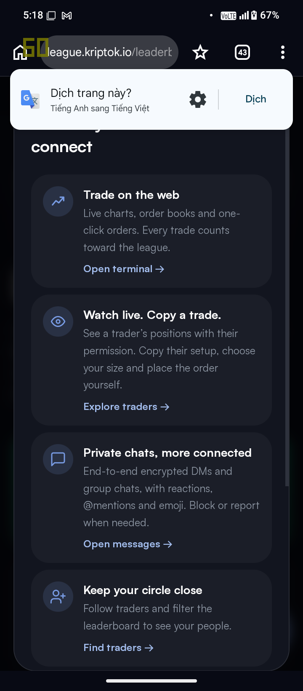
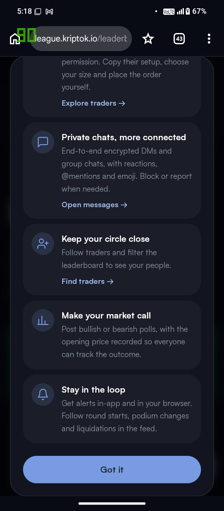

# KriptoK Creator Challenge (@KriptoK & @KriptoKLeague) — Round 6 Leaderboard, Pre-IPO Perpetuals & Tokenized Stocks Analysis

**Superteam Earn Bounty Submission:** KriptoK Creator Challenge (kriptok-creator-challenge-01, 200 USDC Prize Pool)
- **Author / Talent:** @chocolate-hostile-86 (Nhat Viet)
- **X (Twitter) Account:** [@ket4min141](https://x.com/ket4min141) (Following @KriptoK and @KriptoKLeague)
- **KriptoK ID / Wallet:** ket4min141 (2BtGDe2W7RXaxD98MQy9yaDjXpZ5ZQWHSk1mjXWiJJzy)
- **Live 3-Part X Thread URL:** [https://x.com/ket4min141/status/2116294166770769953](https://x.com/ket4min141/status/2116294166770769953)
- **Target Region:** Based in Vietnam, content intended for Global & APAC Solana traders.

---

## 1. Complete 3-Part KriptoK Thread (@ket4min141)

### Piece 1 — KriptoK League Round 6 Leaderboard Story & Market Sentiment
> 1/3 Exploring @KriptoK & @KriptoKLeague Round 6 LIVE! Ranked by % return for $2K round + $14K season prizes! P1 @katana2 (+65.02%) & P2 @juliout lead with 75% Long sentiment: https://league.kriptok.io/leaderboard https://github.com/ket4min-susan/kriptok-creator-2026

### Piece 2 — Pre-IPO Perpetuals (Anthropic), Tokenized Stocks, Self-Custody Earn & Gacha
> 2/3 Why @KriptoK stands out on @solana: Beyond perpetuals (BTC, SOL, HYPE, ZEC, kPEPE, NEAR), @KriptoK unlocks Pre-IPO perpetuals (like Anthropic) & Tokenized Stocks alongside self-custody Earn & Gacha collectibles in one seamless app: https://www.kriptok.io/

### Piece 3 — Contrarian Dip-Buying Analysis (Fear & Greed 35 vs 75% Longs)
> 3/3 In @KriptoKLeague Round 6, Fear & Greed sits at 35 (Fear) yet 75% of open positions are Longs (6 Longs vs 2 Shorts)—showing high-conviction dip buying by top % return traders! Full walkthrough & screenshots: https://github.com/ket4min-susan/kriptok-creator-2026 @KriptoK

---

## 2. Live KriptoK League Round 6 Screenshots

### Leaderboard & Round 6 Countdown ($2,000 Round Pool + $14,000 Season Pool)

### Live Market Tickers, Sentiment (75% Longs / 25% Shorts), and P1 @katana2 (+65.02%)
